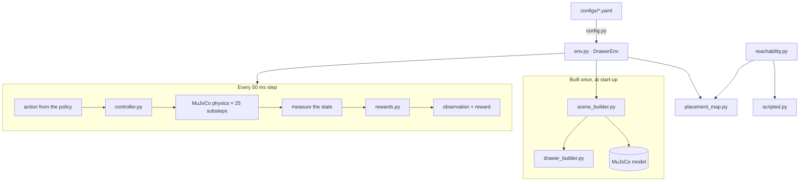

# `drawer_rl/`: the simulation and the RL environment

This package builds the simulated world (table, Kinova Gen3 Lite arm, cabinet) in **MuJoCo**, and wraps it as a
standard **Gymnasium** environment that a reinforcement-learning algorithm can train in.

The learning algorithm itself (SAC) and the neural network come from **Stable-Baselines3**; `scripts/train.py`
connects them to this environment. This package defines everything the robot experiences: the world, what it sees,
how its actions move the arm, and how each step is scored.

## At a glance

| File | Role | In one sentence |
|---|---|---|
| [`env.py`](#envpy) | **The environment** | Resets episodes, applies actions, runs the physics, builds observations, computes rewards |
| [`scene_builder.py`](#scene_builderpy) | World builder | Puts the floor, table, robot mount, arm, cabinet and cameras together into one model |
| [`drawer_builder.py`](#drawer_builderpy) | Cabinet builder | Generates the cabinet, sliding drawer and handle from `configs/drawer.yaml` |
| [`controller.py`](#controllerpy) | Controller | Turns the policy's 5 action numbers into joint motion, within the real arm's limits |
| [`rewards.py`](#rewardspy) | Reward | Scores every step: reach, grasp, pull, minus penalties |
| [`kinematics.py`](#kinematicspy) | Maths | Rotation helpers and inverse kinematics |
| [`placement_map.py`](#placement_mappy) | Placement map | Which drawer positions the arm can open; sampling only those |
| [`reachability.py`](#reachabilitypy) | Feasibility checker | Tests whether the arm can physically open the drawer at a given placement |
| [`scripted.py`](#scriptedpy) | Hand-written controller | Reach → grasp → pull without any learning, as a physics sanity check |
| [`config.py`](#configpy) | Config loader | Loads the YAML files and applies `--set` overrides |
| `__init__.py` | Package marker | Empty; makes `drawer_rl` importable (`from drawer_rl.env import DrawerEnv`) |

## How the pieces fit together



One training step looks like this:

```
policy action (5 numbers in −1…1)
   → controller.py: gripper moves ≤1.25 cm, turns ≤0.05 rad, opens/closes → joint speeds
   → MuJoCo: 25 physics steps of 2 ms
   → env.py: read positions, contacts, forces
   → rewards.py: score the step
   → env.py: build the noisy observation (37–41 numbers)
   → back to the policy
```

---

## `env.py`

**The heart of the package.** It defines `DrawerEnv`, a Gymnasium environment, plus the helper `build_observation()`.
Stable-Baselines3 only ever calls `reset()` and `step()`; everything else is hidden behind those two calls.

### `DrawerEnv.__init__`: once, when the environment is created
1. Loads the configs and builds the MuJoCo world with `scene_builder.build_model()`.
2. Looks up the internal IDs of every arm joint, motor, the gripper, the drawer slide and the handle.
3. Sorts the model's geometry into groups (left fingers, right fingers, rest of the robot, handle, cabinet/table), so
   contacts can be classified as a grasp or a collision.
4. Creates the `DeltaController` and defines `action_space` (5 numbers in −1…1).
5. Solves inverse kinematics for the start pose.
6. Creates the reward function and defines `observation_space` from the list in `task.yaml`.
7. Remembers the nominal friction, gains and grip force, so each episode can randomise around them.
8. Loads the placement map and **checks it matches the current settings**; it refuses to start if it doesn't.

### `reset()`: the start of every episode
* `_randomize()` creates a new situation:
  * the drawer's distance and rotation drawn together from the placement map, plus small sideways and height shifts;
  * slide and handle friction, motor stiffness and grip force;
  * a constant handle-position error, like an imperfect camera calibration.
* The arm goes to the start pose plus small noise, with the gripper open and the drawer 0–1 cm open; the physics
  settles for 50 steps.
* Random action delay (0–100 ms) and camera delay are chosen for the episode, and the first observation is returned.

### `step(action)`: every 50 ms
1. The action waits in a queue for the episode's action delay.
2. `controller.step()` turns it into joint commands.
3. In v8, the drawer rail friction is raised in proportion to the sideways force on the handle (wedging jams it).
4. MuJoCo runs 25 physics steps.
5. `_task_state()` measures everything:
   * gripper and handle positions, drawer opening;
   * whether **both fingers touch the bar with the gripper closed** (a grasp);
   * whether the arm or fingers touch the cabinet or table;
   * the force on the handle, split into pull versus sideways;
   * joint torques against their limits, and joint-limit margins.
6. `rewards.py` scores the step.
7. **Success** = ≥ 15 cm open for 5 steps in a row while grasping. The episode ends after `max_steps`, or immediately
   (reward −10) if the physics becomes unstable.

### Observations: `_obs()`, `_vision_measurement()`, `build_observation()`
* `_vision_measurement()` makes the drawer values (handle position, drawer axis, opening) behave like the real
  camera: noise, the per-episode calibration error, a few steps of delay, and occasional 2–6-step freezes when a tag is
  "hidden".
* Joint and gripper readings get small encoder-like noise.
* **`build_observation()`** flattens everything into one list of numbers. It's a separate, public function on
  purpose: on the real robot, `drawer_vision/bridge/observation.py` calls **the same function** with real sensor and
  camera data, so the policy gets its inputs in exactly the format it was trained on.

### Other methods
| Method | Purpose |
|---|---|
| `render()` | Opens the interactive 3D viewer (`render_mode="human"`) or returns an image for videos (`"rgb_array"`) |
| `set_drawer_offset(off, yaw_deg)` | Place the drawer at a chosen spot (evaluation grids, reachability checks) |
| `sample_drawer_offset()` | A random drawer offset from the configured ranges |
| `_info()` | Extra per-step numbers (opening, grasp, forces, each reward term) that `train.py` logs to TensorBoard |
| `_validate_reachability()` | The start-up check of the placement map |

---

## `scene_builder.py`

Assembles the complete world with MuJoCo's `MjSpec` API, from `robot.yaml`, `drawer.yaml` and `scene.yaml`:

* loads the Gen3 Lite model (`model/kinova_gen3_lite/gen3_lite.xml`) and applies the motor overrides from `robot.yaml`;
* sets the physics options (timestep, integrator, friction cone);
* places the robot base on its **5 cm mount** on the table;
* adds the floor, lighting, the measured table with legs and the mount cylinder;
* adds the cabinet via `drawer_builder.add_cabinet()` at the configured position and rotation;
* turns off collisions between the cabinet and drawer (the slide joint keeps the drawer aligned) and between the
  table and robot base (bolted together);
* adds the fixed cameras from `scene.yaml`.

| Function | Returns |
|---|---|
| `build_model(cfg, spec_hook=None)` | The compiled MuJoCo model. `spec_hook` can add extra things first, e.g. the ArUco tags and virtual camera for vision tests |
| `build_spec(cfg)` | The editable model description before compiling |
| `save_scene_xml(cfg, path)` | Writes the whole world as one XML file (`scripts/build_scene.py` uses it) |

---

## `drawer_builder.py`

Generates the cabinet **procedurally**: there is no drawer model file, every dimension comes from `configs/drawer.yaml`.
Re-measuring the real cabinet only means editing that YAML.

It builds:
* the **carcass**: two side panels, bottom, back, a top slab with its overhang, a shelf for the drawer, the static
  bottom-drawer front and a kick-plate;
* the **top drawer**: a body on a **slide joint** (`top_drawer_slide`) along −x, whose value is the opening in metres,
  with the configured damping, friction and travel. It holds the front panel, the drawer box and an explicit mass;
* the **handle**: a bar on two posts, the 1.9 cm finger gap behind it, and its friction;
* reference **sites**: `handle_site` (the bar's centre, the grasp target) and `drawer_front_site`.

The model names other modules rely on (`CABINET_BODY`, `DRAWER_BODY`, `DRAWER_JOINT`, `HANDLE_BAR_GEOM`,
`HANDLE_SITE`) are defined once at the top of the file. `drawer_geometry()` computes derived values such as the
handle position when closed and the opening direction.

---

## `controller.py`

`DeltaController` turns the policy's action into arm motion. **The same class is used in simulation and on the real
robot** (`drawer_deploy/`), so actions mean exactly the same thing in both.

**The action:** `[dx, dy, dz, yaw, gripper]`, each in −1…1:
* `dx, dy, dz` × 1.25 cm: move the gripper target;
* `yaw` × 0.05 rad: turn the gripper (limited to ±30°);
* `gripper`: −1 closed … +1 open.

What `step(action, data)` does:
1. **Moves a target point** for the gripper, clipped to the workspace box. The target may never lead the real gripper
   by more than ~1.9 cm. Without that limit, the arm kept moving after the policy said "stop" and tore the handle out
   of the gripper.
2. **Inverse kinematics** (damped least squares) works out the joint motion that moves the gripper towards the target
   and keeps it level.
3. **v8 velocity actuation** (`actuation: velocity`):
   * the result is a **joint speed**: the commanded motion plus a gentle correction (`velocity_kp` = 2/s);
   * it's limited per joint in speed and **acceleration**, using the real Kortex limits;
   * the acceleration limit scales the whole change by one factor, so the hand keeps moving in the commanded direction;
   * the speed is integrated into the motor targets, as the Kortex controller does internally.

   v1–v7 used `position` actuation instead (joint targets directly).
4. **Gripper:** the command is rate-limited to the real gripper's speed (2.1 s to close in v8). An instant close
   knocked the hand off the bar.

| Method | Purpose |
|---|---|
| `lead(data)` | How far the target is ahead of the hand. A lead that persists while the hand is blocked means the arm is **pushing**; the policy sees this |
| `relax(data, keep_axis)` | Safety reflex: pull the target back onto the hand so the arm stops pushing, keeping only the pull along the drawer axis |
| `joint_speed_command()` | The limited joint speeds to send to a real velocity-controlled arm |
| `gripper_open_fraction()` | The gripper command as 0 (closed) … 1 (open), what the real gripper is sent |

---

## `rewards.py`

`DrawerReward` scores every step. Each term is computed separately (and logged to TensorBoard as `r_<term>`), then
multiplied by its weight from `task.yaml` (`reward.weights`):

**reward = Σ weight × reward term − Σ weight × penalty term**

| Term | Formula | Encourages / prevents |
|---|---|---|
| `reach` | `1 − tanh(10 × distance gripper→handle)` | Getting close: 0.04 at 20 cm, 0.54 at 6 cm, 0.90 at 1 cm |
| `align` | `cos(angle between gripper and drawer)⁸` | Pointing straight into the drawer |
| `grasp` | 1 if both fingers touch the bar **and** the gripper is mostly closed | Really holding the handle |
| `open` | `opening / 15 cm`, capped at 1, **only while grasping** | Having the drawer open |
| `open_progress` | Progress towards 15 cm this step ÷ 15 cm; **only while grasping**, closing always counts against | Pulling, but not past the target |
| `success` | 1 if ≥ 15 cm open **while grasping** | Reaching and holding the goal |
| `off_axis` | Gripper speed sideways to the drawer axis while grasping | Pulling crooked |
| `collision` | 1 if the arm body touches the cabinet or table | Hitting things |
| `finger_contact` | 1 if a finger touches anything but the handle | Hooking the drawer edge |
| `drawer_speed` | Drawer speed above 0.25 m/s | Yanking |
| `handle_side_force` | Sideways/vertical/inward handle force above 5 N, ÷ 10 N | Wedging the handle (the audit's main finding) |
| `torque_saturation` | Per joint, how far above 85 % of its torque limit | Running joints where the real arm faults |
| `joint_limit` | How far inside the last 10° before a joint limit | Pushing joints past their limits |
| `action`, `action_rate`, `joint_vel` | Squared action, change in action, joint speeds | Large, jerky or fast motion |

Many terms close **loopholes earlier policies found**:
* opening rewards that only count while grasping (a policy hooked the drawer edge instead);
* a grasp that needs a closed gripper;
* progress capped at the target (a policy slammed the drawer to its end stop);
* closing always penalised.

---

## `kinematics.py`

Small maths helpers used by the controller, the environment and the reachability checker:

| Name | What it does |
|---|---|
| `TCP` | The tool centre point: a model site plus a fixed offset. `pos()`, `mat()` (orientation) and `jacobian()` |
| `orientation_from_axes()` | Builds a gripper orientation from "point this way, fingers that way" |
| `rotation_error()`, `rotvec_to_mat()` | Small-angle orientation differences and conversions |
| `dls_step()` | One damped-least-squares IK step: the joint change that best produces a desired gripper motion, stable near singularities |
| `solve_ik()` | Repeats `dls_step` until the gripper reaches a target pose, respecting joint limits. Used for the start pose and the reachability checks |

---

## `placement_map.py`

The **placement map** is a grid of drawer distance offsets × rotations, marking where the arm can physically open
the drawer. It's saved as `configs/placement_map.yaml`.

| Name | What it does |
|---|---|
| `build_map()` | Fills the grid with `reachability.py`. A cell is feasible if all four ±2 cm / ±1 cm jitter corners pass the kinematic checks **and** the centre passes a full-physics scripted pull |
| `PlacementMap` | Loads and saves the map. `safe` = the feasible cells shrunk by one cell (`erode`) as a safety margin |
| `sample()` | A random (distance, rotation) inside the training ranges, **only from safe cells**. `env.py` uses this every reset |
| `is_safe()`, `safe_fraction()` | Is one placement safe? What share of the training box is? |
| `check_matches()` | Compares the map's **fingerprint** (table, mount, drawer placement, start pose, speed limits, gripper speed, …) with the current configs and lists what changed. A stale map makes the env refuse to start |

---

## `reachability.py`

`ReachabilityChecker.check(offset, yaw_deg)` answers: **can the arm physically open the drawer here?** It returns a
`PlacementCheck` with the verdict, the reasons for failure and margins. The checks:

1. **Layout:** the cabinet fits on the table (allowing the configured overhang, but never with its centre off the edge).
2. **Approach:** inverse kinematics from the real start pose to the closed handle, turning the gripper gradually, with
   no jumps to another arm posture.
3. **Pull:** inverse kinematics with the gripper on the handle at every opening from closed to 18 cm, along one
   continuous joint path.
4. **Margins:** every joint at least 5° from its limit; no singularity (smallest Jacobian singular value ≥ 0.02).
5. **Clearance:** no arm or finger contact with the cabinet or table along the path; the handle stays inside the
   controller workspace.
6. **Dynamics** (optional): a scripted grasp-and-pull (`scripted.py`) really opens the drawer in full physics.

`sweep()` and `feasible_interval()` check a line of distances. `scripts/check_reachability.py` uses all of this to
draw the feasible band and build the placement map.

---

## `scripted.py`

`run_scripted(env, ...)` runs one episode with a **hand-written controller, no learning**:

1. **Approach:** line up 6 cm in front of the handle and turn the gripper to face the drawer.
2. **Insert:** move straight in until the bar is between the fingers.
3. **Grasp:** close and wait for the slow gripper.
4. **Pull:** pull along the drawer axis at a steady 10 cm/s until 17 cm, then hold.

It reads the true state from the simulator and sends actions in the same 5-number format as the policy, through the
same controller. Under v8 it "goes compliant" once it grips: it stops pushing except along the drawer axis, which
drops the sideways handle load from ~40 N to 2–6 N.

**Why it exists:** if this controller can open the drawer, the physics allows the task, so a failing policy is a
learning problem rather than a broken simulation. It's used by the reachability checker, by
`scripts/scripted_demo.py` (watch it with `--viewer`) and as the deploy loop's fallback agent.

---

## `config.py`

| Function | What it does |
|---|---|
| `load_env_config(paths, overrides)` | Loads `robot`, `drawer`, `scene` and `task` YAML into one dict `{"robot": …, "drawer": …, …}` and applies overrides |
| `apply_overrides(cfg, ["a.b.c=value", …])` | The `--set` mechanism. Values are parsed as YAML (`3`, `[0.6, 1.6]`, `true`); numeric parts index lists (`markers.drawer.0.size=0.068`) |
| `load_yaml()`, `save_yaml()` | Read and write YAML; saving creates missing folders |
| `resolve_path()`, `PROJECT_ROOT` | Relative paths are resolved from the project root, so scripts work from any directory |

---

## Using it from Python

```python
from drawer_rl.env import DrawerEnv

env = DrawerEnv()                                        # default configs
env = DrawerEnv(overrides=["drawer.top_drawer.slide.damping=12"])
env = DrawerEnv(render_mode="human")                     # with the 3D viewer

obs, info = env.reset(seed=0)
for _ in range(300):
    obs, reward, terminated, truncated, info = env.step(env.action_space.sample())
    env.render()
```

Run the hand-written controller in the viewer:

```bash
.venv/bin/python scripts/scripted_demo.py --viewer
```
